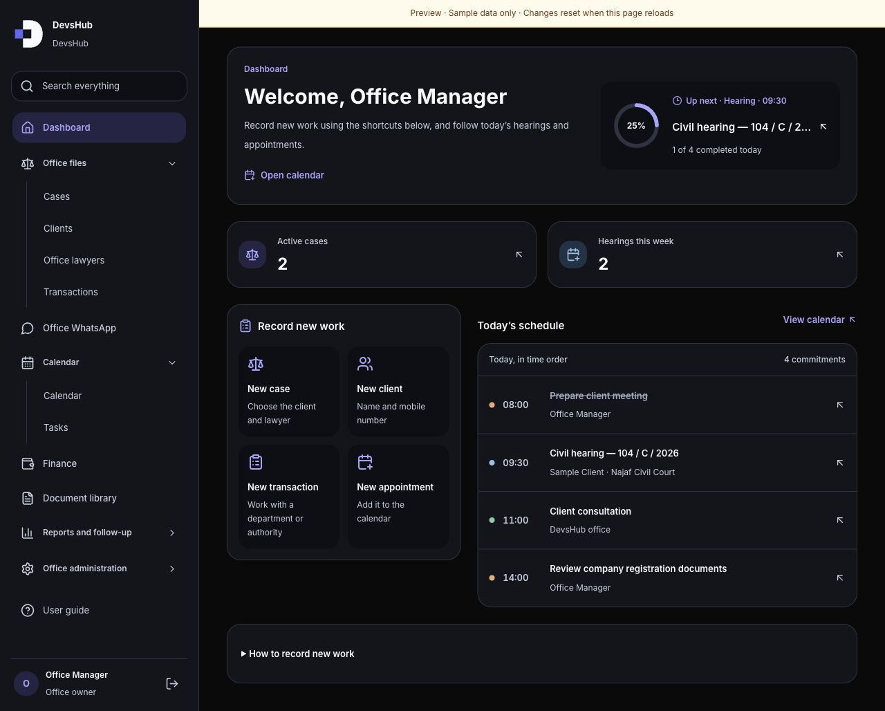
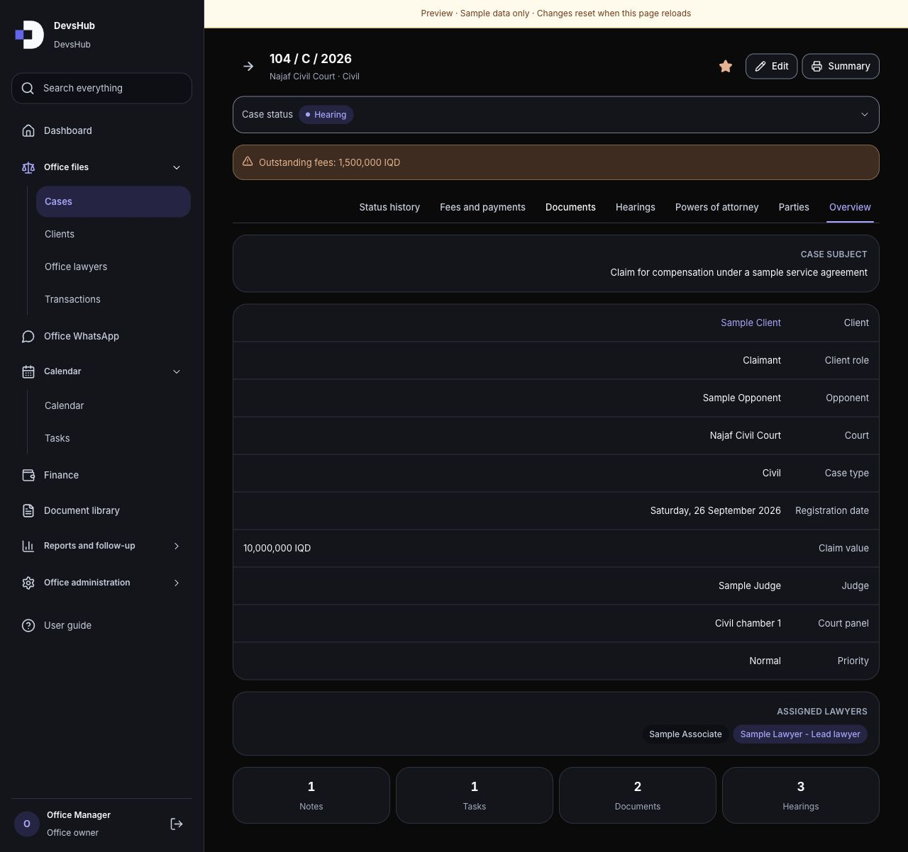
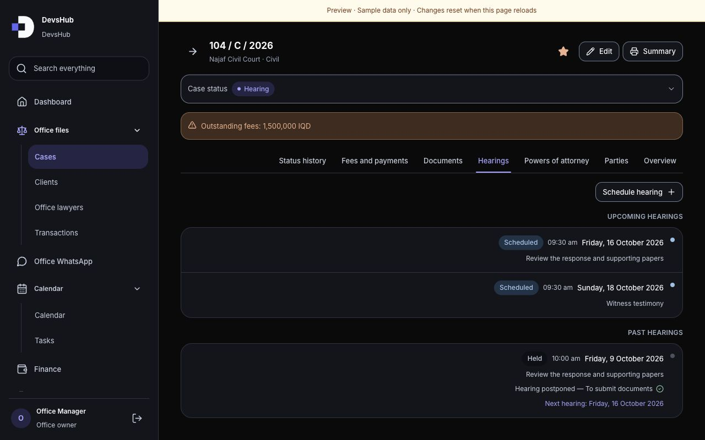
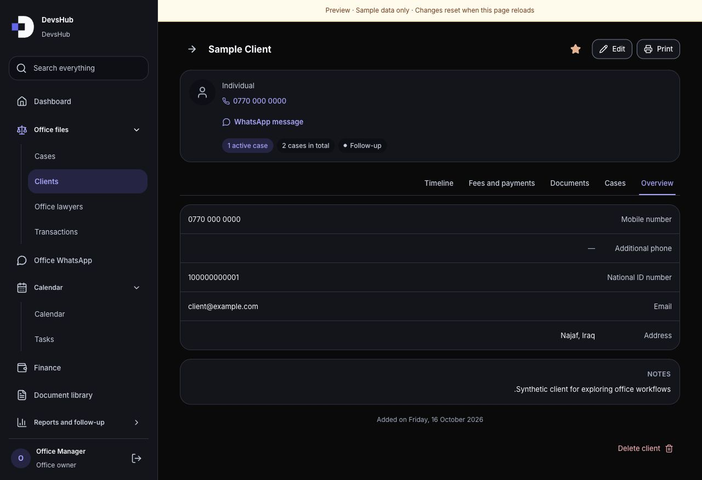
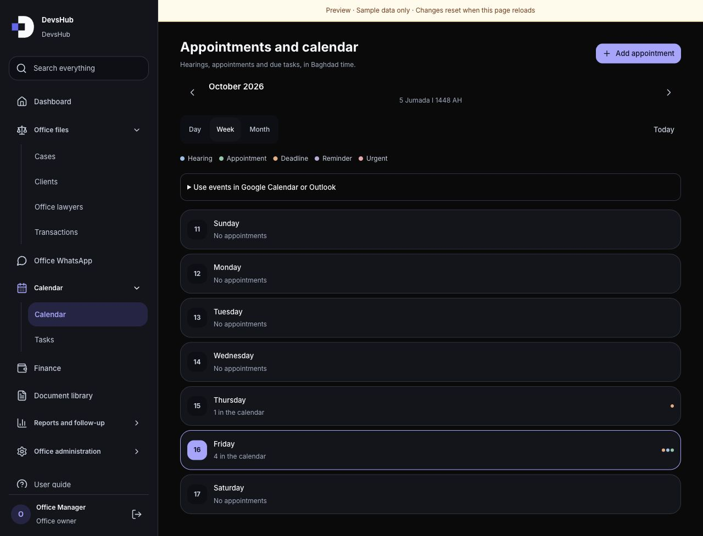
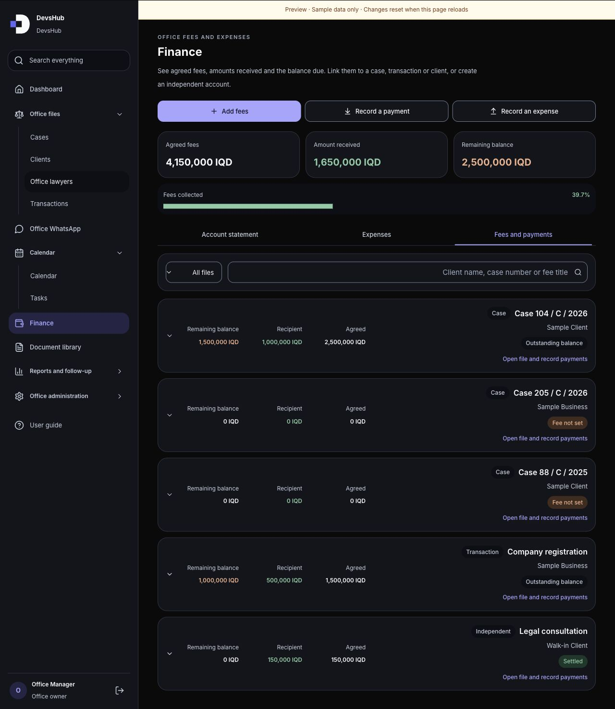
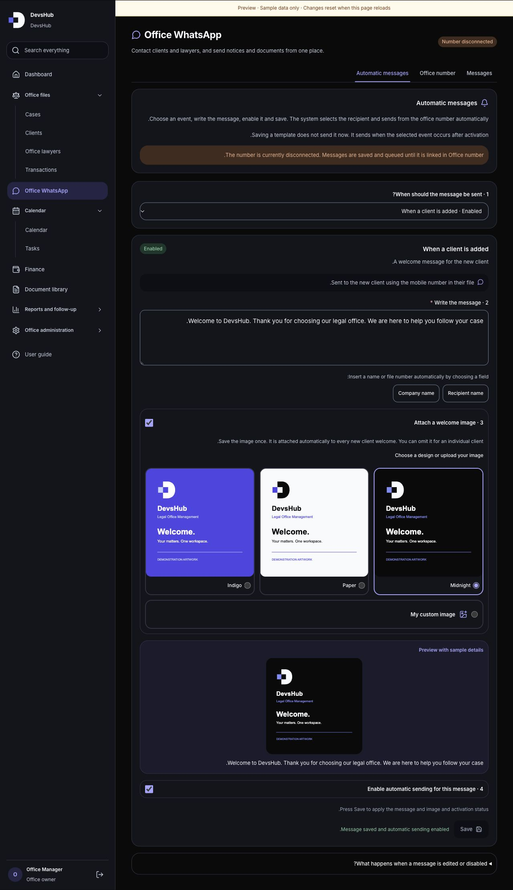

  

# DevsHub Legal Office Management

**One workspace for cases, clients, hearings, documents, finance and communication.**

[**Explore the live preview**](https://apil-sin-frontend-preview.vercel.app) · [**Contact the project owner**](https://github.com/HostX0)

> **Interactive frontend preview only.** This public demo uses synthetic sample records and is completely separate from the live product. It contains no production backend, customer database or real account access. To obtain the complete system or discuss a customized version, [contact the account owner](https://github.com/HostX0).

_Start the day with the next hearing, completion progress, active cases and quick shortcuts for new work._

## The problem it solves

Legal offices often track clients, court dates, case papers, fees and conversations in separate places. Finding the latest case status or the correct balance can mean searching through folders, spreadsheets and messages.

DevsHub brings that work into connected client and case files. Staff can follow a matter from registration through hearings, documents, payments and later follow-up without losing its context.

## Explore the product

| Area                  | What the workspace brings together                                                                   |
| --------------------- | ---------------------------------------------------------------------------------------------------- |
| Daily dashboard       | Upcoming work, office activity, completion progress and quick entry shortcuts.                       |
| Clients and lawyers   | Searchable profiles, contact details, assigned lawyers and connected case history.                   |
| Case management       | Case numbers, courts, parties, priorities, powers of attorney, hearings and status history.          |
| Calendar and tasks    | Day, week and month views for appointments, hearings, deadlines and assigned tasks.                  |
| Transactions          | Department and authority work linked to the relevant client and responsible lawyer.                  |
| Finance               | Agreed fees, payments, outstanding balances, expenses and case, transaction or independent accounts. |
| Documents             | A searchable document library and document sections inside the relevant files.                       |
| Communication         | Recipient selection, sample message history, welcome designs and automatic-message settings.         |
| Office administration | Office profile, users, role permissions, follow-up lists, statistics and audit-history screens.      |
| Everyday usability    | A responsive interface, light and dark themes, search, filters, favourites and contextual guidance.  |

## A closer look

### A complete case file

_Keep the case subject, court, parties and responsible lawyers together. Tabs lead to powers of attorney, hearings, documents, fees and status history._

### Hearing follow-up

_See scheduled hearings and past outcomes in the same case file, including postponements and the next hearing date._

### Connected client profiles

_Open one profile for the client's details, cases, documents, fees and timeline. Sample records make the journey easy to explore._

### Clear calendar planning

_Switch between day, week and month views and follow commitments in Baghdad time._

### Fees and payments in context

_Review collection progress and open the financial file for a case, transaction or independent service._

### Communication with a consistent identity

_Explore message templates, recipient fields and DevsHub welcome designs. This preview demonstrates the settings without sending messages to anyone._

## Try the demo

1. Open the [live preview](https://apil-sin-frontend-preview.vercel.app). It starts with a sample office manager; no registration is needed.
2. Review the dashboard, then open a sample case and explore its tabs.
3. Visit the related client profile, calendar, tasks and finance workspace.
4. Add a fictional client or edit a sample record to try the local interactions.
5. Explore communication and office-administration screens. Reload the page to restore the original sample records.

Use fictional information only. Sample changes stay in the current browser session's memory and reset on a full reload. Visual preferences may remain on that browser.

## What this preview includes

This is an interactive product demonstration with the main workspace screens, synthetic records, navigation, search, filters, forms and local sample interactions. Its separate repository and demo deployment have no connection to the live application's records or services.

Real sign-in and account security, file uploads and downloads, PDF generation, messaging and email delivery, browser push, backup exports and restore operations are outside this frontend demo. Controls that require those services display a preview limitation. No messages are sent and no production data is read or changed.

## Get the complete system

For the complete application, a guided demonstration, branding or a version tailored to your office, **[contact the project owner](https://github.com/HostX0)**.
